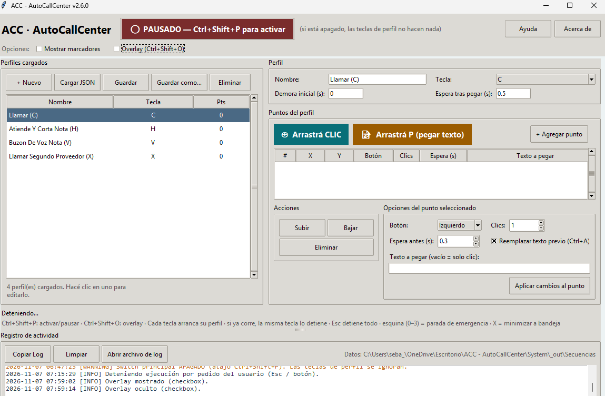

[⬇️ **Descargar para Windows**](https://github.com/sebastianbocek/ACC-AutoCallCenter/releases/latest/download/ACC-AutoCallCenter.exe)

# ACC · AutoCallCenter

**Automatizá tareas repetitivas del call center con una sola tecla.**

ACC (AutoCallCenter) es una aplicación de escritorio para Windows que permite crear macros configurables con clics y texto. Un agente puede reemplazar una serie de acciones repetidas —por ejemplo, abrir una opción, completar un campo y registrar una nota frecuente— por la activación de un perfil con una tecla.

El objetivo es reducir la carga mecánica de la operación diaria y liberar tiempo para que los agentes puedan enfocarse en conversar y atender más oportunidades de venta.

> ACC automatiza interacciones según las coordenadas y acciones que configure cada persona. No se integra directamente con un CRM ni garantiza resultados comerciales; probá cada perfil en tu entorno antes de usarlo en producción.



## Funcionalidades

- Perfiles de automatización independientes, cada uno asignado a una tecla.
- Secuencias editables de clics izquierdos, derechos o centrales.
- Pegado de texto para notas y respuestas frecuentes, con opción de reemplazar el contenido previo.
- Demoras configurables entre acciones para adaptarse a cada aplicación.
- Captura de puntos arrastrando el botón correspondiente hacia el lugar deseado de la pantalla.
- Guardado y carga de perfiles en formato JSON.
- Activación y pausa global, overlay de estado y registro de actividad.
- Tecla de emergencia **Esc** para detener una secuencia en curso.

## Requisitos

- Windows 10 u 11.
- Python 3.10 o posterior para ejecutar desde el código fuente.

## Instalación desde el código fuente

```powershell
git clone https://github.com/sebastianbocek/ACC-AutoCallCenter.git
cd ACC-AutoCallCenter
py -m venv .venv
.\.venv\Scripts\Activate.ps1
pip install -r requirements.txt
python "ACC - AutoCallCenter.py"
```

La bandeja del sistema es opcional. Para habilitarla, instalá también las dependencias opcionales:

```powershell
pip install -r requirements-optional.txt
```

## Uso rápido

1. Abrí ACC y creá un perfil con **+ Nuevo**.
2. Elegí su nombre y la tecla que lo activa.
3. Agregá puntos de clic o acciones de pegado de texto, y configurá sus demoras.
4. Guardá el perfil y probalo en el sistema de destino.
5. Activá ACC con **Ctrl+Shift+P** y ejecutá el perfil con su tecla asignada.

La misma tecla del perfil detiene la secuencia que está ejecutándose. **Esc** detiene la ejecución de inmediato. **Ctrl+Shift+P** pausa o reactiva todos los perfiles; **Ctrl+Shift+O** muestra u oculta el overlay.

## Datos y privacidad

Los perfiles, ajustes, sesión y registros se guardan localmente en la carpeta `Secuencias`, junto al programa. Revisá el contenido de los perfiles antes de compartirlos: una secuencia puede incluir texto escrito por el usuario o coordenadas específicas de su entorno. No incluyas información personal, credenciales ni datos de clientes en los archivos del repositorio.

## Desarrollo

La interfaz está construida con Tkinter; la captura de teclado y mouse utiliza `pynput`. Las dependencias opcionales `pystray` y `Pillow` habilitan el icono de bandeja.

## Alcance y uso responsable

Usá ACC de acuerdo con las políticas de tu organización y las condiciones de las aplicaciones donde lo ejecutes. Verificá que cada acción y nota sea correcta antes de iniciar una secuencia y mantené visible la posibilidad de pausar o detenerla.

## Contribuciones

Las sugerencias, reportes de errores y mejoras son bienvenidos. Al abrir un issue, describí el comportamiento esperado, los pasos para reproducirlo y la versión de Windows y ACC involucrada. No adjuntes registros ni perfiles que contengan información de clientes.

## Autor

Sebastián Bocek · [GitHub](https://github.com/sebastianbocek)
